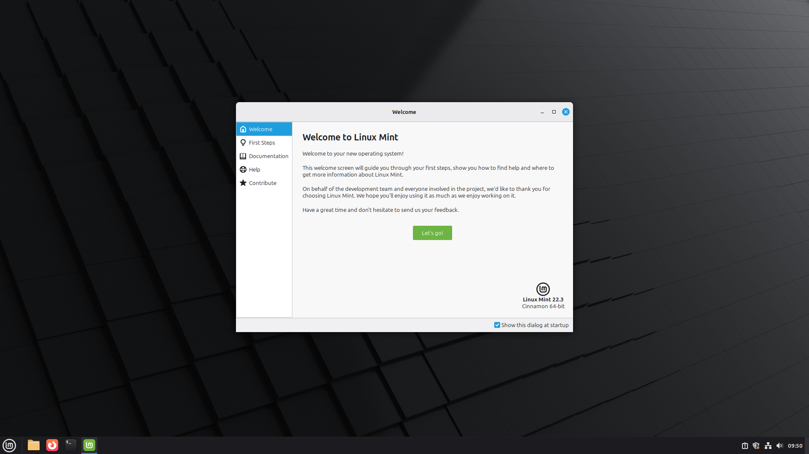
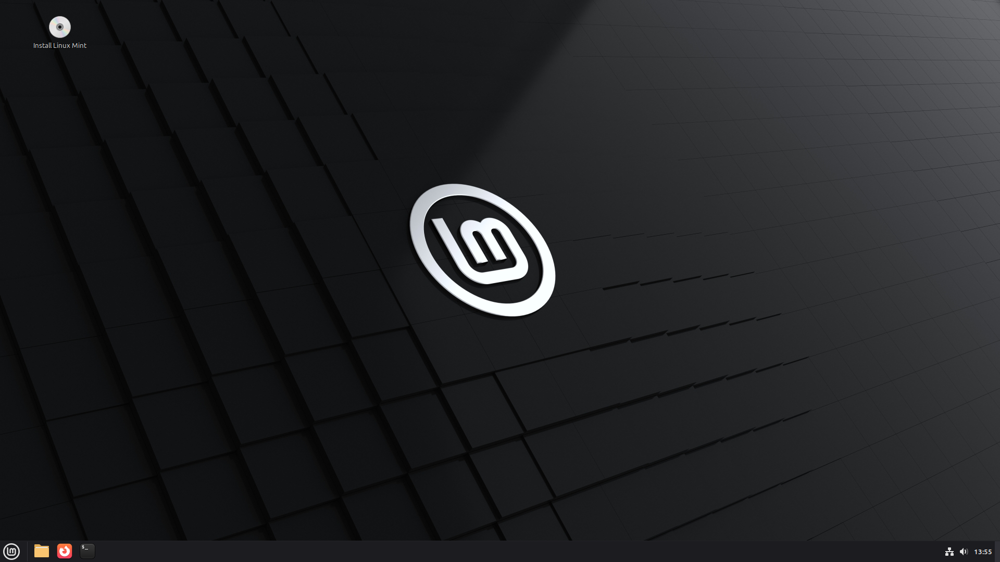
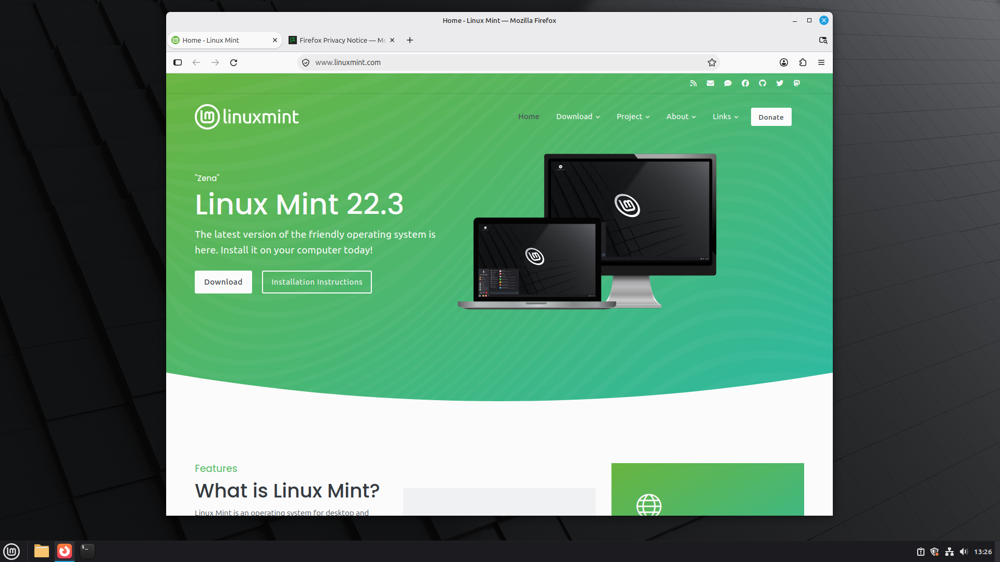

# Linux Mint ARM

Linux Mint 22.3 "Zena" with Cinnamon, rebuilt for ARM64 so it runs at native speed in a virtual machine on a Mac with Apple silicon. It comes two ways: a ready-to-run [UTM](https://mac.getutm.app) virtual machine and a live/install ISO. Both are made from the package list of the official x86 ISO, trimmed to be light in a VM: a 1.65 GB ISO instead of 3.09 GB, and 4.65 GB installed instead of 8.35 GB.

This is an **unofficial** build. The Linux Mint team did not make it, does not endorse it and does not support it.

## What it does

- **The real Linux Mint, on ARM.** You get Cinnamon 6.6.9, Nemo and the X-Apps, plus Update Manager, Software Manager, Timeshift and Mint's themes and artwork. Mint's own installer is there too, with its live session and OEM mode. All 48 Linux Mint source packages that contain compiled code were rebuilt for ARM64 from Linux Mint's published sources. Mint's other packages are used as published.
- **Ready in three clicks.** Unzip the virtual machine, double-click it, press Play. Linux Mint's first-start wizard asks for your language, keyboard, time zone and account.
- **Or install from the ISO**, in UTM or another VM app that boots ARM64 UEFI images, with Mint's installer exactly as on a PC.
- **A GPU-accelerated desktop.** The Mac's GPU draws the desktop through Metal (UTM's *GPU Supported* display). glmark2 scores 1,608 instead of 162 on the CPU-drawn display, and the idle desktop costs the Mac 4.9 % of one core instead of 13.4 %.
- **Light.** 1,613 packages instead of 2,005. There is no firmware or driver for hardware a VM doesn't have. LibreOffice and the other large applications are one click away in the Software Manager.
- **Made for a virtual machine.** Swap is compressed in RAM. Clipboard sharing, automatic resizing, shared folders and the QEMU guest agent work out of the box, and VMware Fusion's tools are installed. Under Apple's Virtualization framework, Rosetta can run x86-64 Linux programs ([manual](docs/manual.md#9-rosetta-for-x86-64-programs)).
- **Updates keep working.** Update Manager brings Ubuntu's base and security updates from Ubuntu's ARM mirrors, and Software Sources is patched to offer them; Update Manager is patched too, so it keeps the right kernel. Firefox is Mozilla's own ARM64 build, updated by Mozilla. Linux Mint's versions of its packages stay pinned, as on any Mint system.
- **Quick.** The installed system's kernel and services are up in 1.5 seconds. The desktop runs in 0.9 GB of memory.
- **Rebuilt with one command.** `./build.sh` makes the ISO and the virtual machine from scratch on a Mac, in about 35 minutes on an M4 Max.

| Live session | First start | Firefox, native ARM64 |
| --- | --- | --- |
|  |  |  |

## Quick start

You need a Mac with Apple silicon and [UTM](https://mac.getutm.app) 4.7 or newer (free).

1. Download `linuxmint-22.3-cinnamon-arm64-unofficial-utm.zip` from the [latest release](https://github.com/GodisGood-GodisGreat-and-GodisReal-Amen/Mint-ARM/releases/latest), and double-click it to unzip it.
2. Double-click **Linux Mint 22.3 ARM.utm**. UTM opens and adds it to its list.
3. Press **Play**. Linux Mint's setup asks for your language, keyboard, time zone and account, then starts the desktop.

The ISO is on the same release page. The [startup guide](docs/getting-started.md) covers installing from it, checking the downloads and the first things to do.

## Documentation

- [Getting started](docs/getting-started.md): requirements, the ready-made VM, installing from the ISO, first steps.
- [User manual](docs/manual.md): everything that differs from Linux Mint on a PC, including the display, sharing with the Mac, updates, software, memory, Rosetta and the VM's settings.
- [Building it yourself](docs/building.md): the one-command build, its stages, changing what goes in, and the test tools.
- [How it works](docs/architecture.md): the package rebuild, the pinned local archive, the ISO and the preinstalled VM.
- [Troubleshooting](docs/troubleshooting.md): what to do when something does not work.
- [Contributing](CONTRIBUTING.md) and the [changelog](CHANGELOG.md).

## How it works, in one paragraph

Linux Mint 22.3 is Ubuntu 24.04 plus Linux Mint's own packages, and Linux Mint publishes those for x86 only. The build starts an Ubuntu 24.04 ARM64 virtual machine on the Mac. Inside it, Mint's 48 source packages that contain compiled code are rebuilt in four layers, each needing only earlier ones to build. Mint's architecture-independent packages are taken as they are. The original ISO's package list, trimmed for a VM, is then installed onto Ubuntu's ARM64 base from `ports.ubuntu.com`. A signed local "Linux Mint ARM" package archive inside the system holds Mint's packages at the priority Linux Mint gives its own repository, so Ubuntu's updates never replace them. The system is packed into an ISO with Mint's live session and installer. Mint's installer then preinstalls that ISO into the UTM VM in OEM mode, so its first start runs Mint's setup wizard. [How it works](docs/architecture.md) has the details.

## Why a virtual machine

No Linux distribution boots directly on an M4 Mac yet. [Asahi Linux](https://asahilinux.org) supports the M1 and M2, the M3 is in progress, and the M4 has neither an installer nor a GPU driver ([Asahi's M4 status](https://asahilinux.org/docs/platform/feature-support/m4/)). In a virtual machine on Apple's hypervisor, Linux Mint runs on the Mac's own cores at native speed. That works on any Mac with Apple silicon. The build was made and measured on an M4 Max.

## Privacy and network use

The system talks to the same servers as Linux Mint and adds nothing of its own: no telemetry, no account. Update Manager and apt fetch package lists and updates from Ubuntu's ARM mirrors and from Mozilla's apt repository. They also check Linux Mint's repository, which carries no ARM64 packages. Firefox goes wherever you browse.

The build downloads from `cloud-images.ubuntu.com`, `ports.ubuntu.com`, `packages.linuxmint.com` and `packages.mozilla.org`, and nothing else. The published ISO and virtual machine were checked for traces of the machine that built them and carry none: no user or host names, keys, paths or network details. Each copy of the VM makes its own machine ID on its first start.

## License

The build scripts, the tools, the documentation, and what this project makes (`mint-arm-system`, `mint-arm-repo`, the `firefox-locale-*` transition packages, and the patches to Software Sources and Update Manager) are public domain. They are released under [The Unlicense](LICENSE): copy them, change them, sell them, build on them, no credit needed.

The ISO and the virtual machine contain software by Ubuntu, Linux Mint, Mozilla and many others, each under its own license, mostly free-software licenses such as the GNU GPL. Each package's license is in `/usr/share/doc/<package>/copyright` inside the system. Every release also carries the source code of each Linux Mint package rebuilt for it, and a list of every source package in the images with where to get it.

Linux Mint's name and logo belong to the Linux Mint project. Ubuntu is a trademark of Canonical Ltd., Firefox of the Mozilla Foundation, Linux of Linus Torvalds, and Apple, Mac and Rosetta of Apple Inc. This project is not affiliated with any of them. The system keeps Linux Mint's name and artwork because it is Linux Mint's software, rebuilt. Please report problems with this build [here](https://github.com/GodisGood-GodisGreat-and-GodisReal-Amen/Mint-ARM/issues), not to the Linux Mint team.
