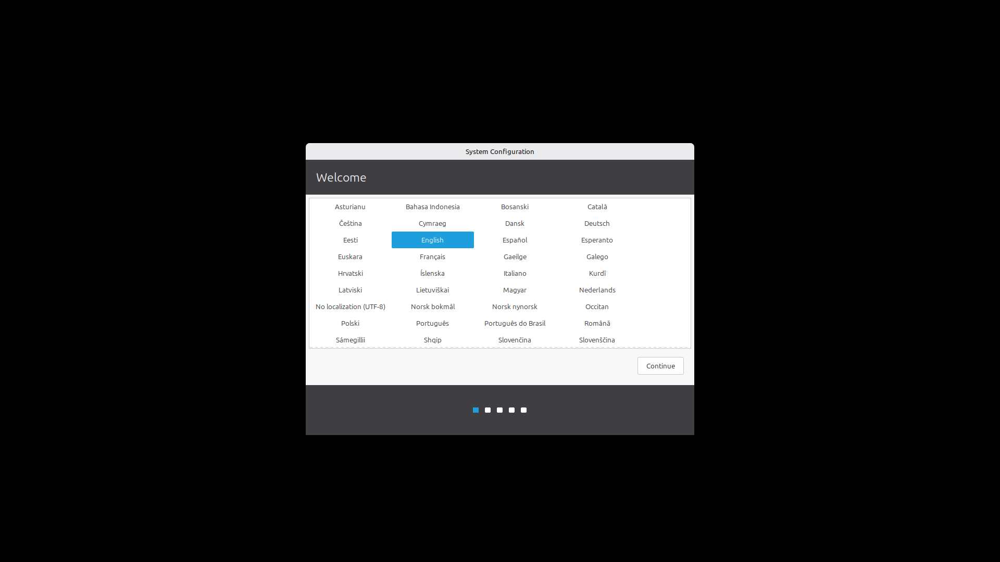
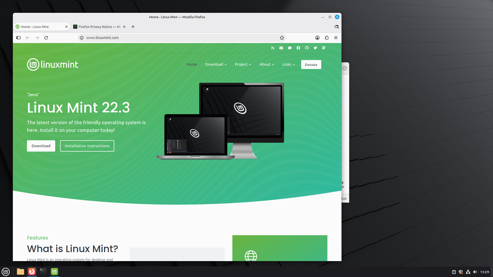
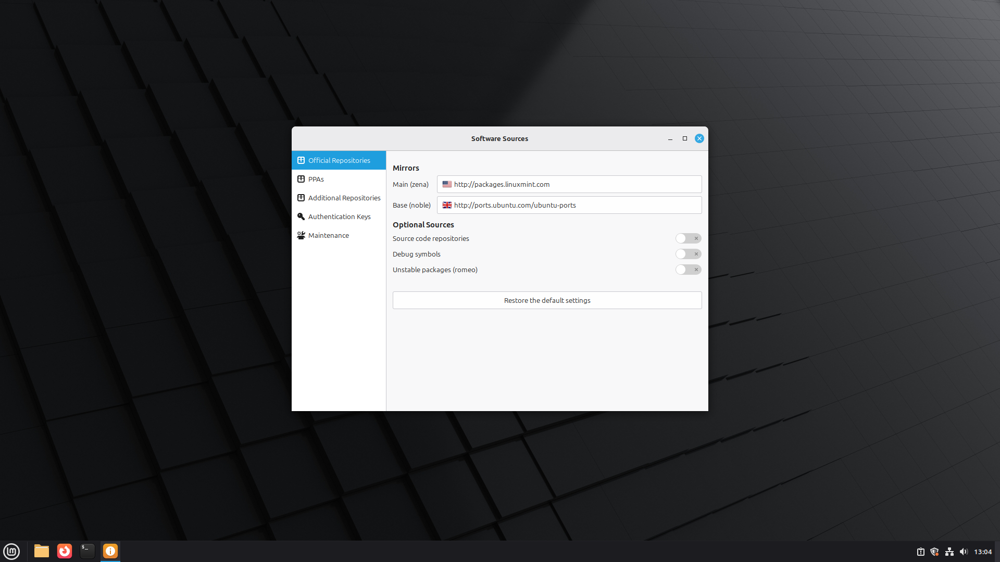

# Linux Mint ARM user manual

Everything that differs from Linux Mint on a PC, in the order you meet it. Sections 3 to 11 are about virtual machines on a Mac, and [section 14](#14-raspberry-pi) is about the Raspberry Pi; the rest applies to both. For Linux Mint itself (the desktop, the applications, the tools), Linux Mint's own [documentation](https://linuxmint.com/documentation.php) applies unchanged; the *Welcome* screen links to it too.

## Contents

1. [One image, two kinds of machine](#1-one-image-two-kinds-of-machine)
2. [The first start](#2-the-first-start)
3. [The display](#3-the-display)
4. [Sharing with the Mac](#4-sharing-with-the-mac)
5. [Keyboard and mouse](#5-keyboard-and-mouse)
6. [Updates](#6-updates)
7. [Installing software](#7-installing-software)
8. [Rosetta for x86-64 programs](#8-rosetta-for-x86-64-programs)
9. [Memory and swap](#9-memory-and-swap)
10. [Disk space](#10-disk-space)
11. [The virtual machine's settings](#11-the-virtual-machines-settings)
12. [What was left out](#12-what-was-left-out)
13. [What this build adds to Linux Mint](#13-what-this-build-adds-to-linux-mint)
14. [Raspberry Pi](#14-raspberry-pi)

## 1. One image, two kinds of machine

Linux Mint ARM is one disk image, already installed, that starts in two ways:

- **in a virtual machine**: the VM's UEFI firmware starts GRUB from the image's boot partition, and GRUB starts the hardware-enablement kernel (7.0 at the time of this release) in its *virtual* flavour;
- **on a Raspberry Pi** 4 or 5: the Pi's firmware reads `config.txt` from the same partition and starts Ubuntu's Raspberry Pi kernel from it.

Until its first start the image carries both machines' kernels, boot files and tools. The first start keeps what its machine uses and removes the rest, so a Pi carries nothing of the VM's and a VM nothing of the Pi's. The ready-made UTM VM is the same image with that already done.

## 2. The first start



The image is installed, but nothing in it is personal yet. Its first start does three things, then the system starts normally:

1. **It fits the disk.** The system partition grows to fill the card, or the virtual disk.
2. **It removes what the machine does not use**, in a minute or two (the screen stays on the start-up logo meanwhile):
   - in a virtual machine: the Raspberry Pi's kernel, firmware, boot tools and settings, and Bluetooth, Wi-Fi, printing and scanning support, which a VM on a Mac has no use for; the boot partition becomes the UEFI system partition, at `/boot/efi`;
   - on a Raspberry Pi: the virtual machines' kernel, GRUB and shim, and the VM guest tools (`spice-vdagent`, the QEMU guest agent, VMware's tools).

   A package that something staying still needs is kept. On a Pi, the setup wizard itself needs some of GRUB's tools, so those go right after it.
3. **It runs *System Configuration***: your language, keyboard layout, time zone, and your name, the computer's name, username and password. It then removes the temporary account the system was prepared with. Every copy of the image gets its own machine ID and random seed at this point.

`journalctl -u mint-arm-first-start -u mint-arm-first-start-late` shows what the first start removed.

## 3. The display

UTM offers two display cards for a QEMU virtual machine, chosen in the VM's settings › *Display* › *Emulated Display Card*. The ready-made VM uses the first.

| | **virtio-gpu-gl-pci** (*GPU Supported*) | **virtio-gpu-pci** |
| --- | --- | --- |
| Drawn by | the Mac's GPU: Mesa's VirGL driver in Linux, virglrenderer and ANGLE on the Mac, onto Metal | the VM's CPU (Mesa's llvmpipe) |
| OpenGL for programs | 2.1, and OpenGL ES 3.0 | 4.5 |
| glmark2 at 1280×720 | **1,608** | 162 |
| The Mac's CPU while the desktop is idle | **4.9 %** of one core | 13.4 % of one core |

Measured on an M4 Max with UTM's own QEMU, virglrenderer and ANGLE, with a 1920×1080 desktop.

The GPU display is the better choice for the desktop and most applications: Cinnamon's effects, video playback and GTK 4 applications all run on it. Its limit is OpenGL 2.1: a program that needs a newer OpenGL (Blender, OBS Studio and some games, for example) refuses to start. For those:

- run just that program on the CPU: `LIBGL_ALWAYS_SOFTWARE=1 blender` (from a terminal, or in the launcher's command);
- or switch the VM to `virtio-gpu-pci` while you use them;
- or try UTM's *Apple Core OpenGL* renderer (UTM › Settings › Display › *Renderer Backend*), which UTM documents as offering OpenGL 4.1 to the guest. It has not been tested with this build.

**Firefox** draws pages with its own software renderer, set by this build's virtual-machine settings (`gfx.webrender.software`, in `/usr/lib/firefox/defaults/pref/mint-arm-vm.js`). Drawing through UTM's accelerated OpenGL, Firefox showed pages and tabs without any text. Software rendering is fast enough for normal browsing on an Apple-silicon Mac. To try GPU drawing anyway, set `gfx.webrender.software` to `false` in `about:config` and restart Firefox.

**Vulkan** is not installed. UTM can pass Vulkan through to Linux (Mesa's Venus driver): install `mesa-vulkan-drivers` and see [UTM's notes](https://docs.getutm.app/guest-support/linux/). Untested here.



**Resolution.** The desktop follows the size of UTM's window (the *Auto Resolution* option of UTM's display, done in Linux by `spice-vdagent`). UTM's *Retina Mode* is off: Linux draws at the window's size in points and macOS scales it, which is UTM's recommendation. For larger text and controls, use Cinnamon's *Display* settings › *User interface scaling*; for sharper text on a Retina screen, turn UTM's *Retina Mode* on and choose *Double (Hi-DPI)* scaling there.

## 4. Sharing with the Mac

**Clipboard.** Copy in one, paste in the other (`spice-vdagent` in Linux, and UTM's *Sharing* › *Enable Clipboard Sharing*, which is on in the ready-made VM).

**A shared folder.** In UTM, choose the folder with the folder button in the VM's toolbar (or *Sharing* in its settings). The ready-made VM uses UTM's *SPICE WebDAV* mode: inside Linux, `spice-webdavd` serves the folder at `http://127.0.0.1:9843`. To open it in Nemo, press **Ctrl+L**, type `dav://127.0.0.1:9843`, press Enter, and bookmark it with **Ctrl+D**.

UTM's other mode, *VirtFS*, mounts the folder as a file system instead (the kernel's `9p` driver is installed). Choose *VirtFS* in UTM's *Sharing* settings, then follow [UTM's instructions](https://docs.getutm.app/guest-support/linux/#virtfs): one line in `/etc/fstab`. Under Apple's Virtualization framework the folder arrives as *VirtioFS*: `sudo mkdir -p /mnt/share && sudo mount -t virtiofs share /mnt/share`.

**USB devices.** Turn on *USB Sharing* in the VM's settings › *Input*, then connect a device from the USB button in the VM's toolbar.

## 5. Keyboard and mouse

Shortcuts inside Linux use **Ctrl** (Ctrl+C, Ctrl+V); the Mac's **⌘** key reaches Linux as the Super key, which opens Cinnamon's menu. UTM can swap ⌘ and Ctrl for you (UTM › Settings › Input › *Control, Option, and Command keys*), so that ⌘C copies in Linux too.

If the mouse or keyboard is captured by the VM, **Control+Option** releases it. Scrolling direction can be set in Cinnamon's *Mouse and Touchpad* settings, or for all VMs with UTM's *Invert scrolling* option.

## 6. Updates

**Update Manager** works as on any Linux Mint, and three kinds of updates arrive through it:

- **Ubuntu's base and security updates**, from Ubuntu's archive for ARM, `ports.ubuntu.com` (the `noble`, `noble-updates`, `noble-backports` and `noble-security` suites). This includes the kernel: Ubuntu 24.04's hardware-enablement kernel, the line Linux Mint 22.3 uses too (7.0 at the time of this release), in its *virtual* flavour, the same kernel without the firmware for physical hardware. Update Manager keeps it up to date; Linux Mint's own version did not recognise this kernel line on ARM, and offered a 64k-page kernel instead, which Apple silicon cannot start, so this build's version is patched. (On a Raspberry Pi the kernel is Ubuntu's Raspberry Pi kernel instead: [section 14](#14-raspberry-pi).)
- **Firefox**, from Mozilla's own apt repository (`packages.mozilla.org`, ARM64). Firefox's built-in updater is off, as on Linux Mint.
- **Linux Mint's own packages** (Cinnamon, Nemo, the X-Apps, the Mint tools) come from the *Linux Mint ARM* archive stored in the system itself (`/usr/share/mint-arm/repo`). Linux Mint publishes no ARM64 packages, so these stay at the versions built for this release. A newer release of this project carries a `mint-arm-repo` package: install it (double-click it, or `sudo apt install ./mint-arm-repo_*.deb`), then run Update Manager to get the newer Mint packages. When Update Manager itself has an update, it offers only that one first, as on any Linux Mint; the rest appears at its next check.

The archive has the same priority (700) as Linux Mint's own repository, so Ubuntu's packages never replace Linux Mint's versions, even when Ubuntu's are numbered higher. `base-files`, which makes the system Linux Mint, is one example; GNOME Calculator 41 and Zenity 3.44, which Mint keeps on GTK 3, are others. The line for Linux Mint's repository stays in the sources, as on any Linux Mint system; apt finds no ARM64 packages there and moves on.

**Software Sources** offers Ubuntu's ARM mirrors for the *Base* repository, thirteen of them in ten countries, `ports.ubuntu.com` included, with Linux Mint's speed test. The stock tool only knows Ubuntu's x86 mirrors, where switching would have broken updates; this build patches it (see [How it works](architecture.md#software-sources-for-arm)). Linux Mint's own mirrors, offered for the *Main* repository, carry no ARM64 packages either way, so which one is chosen does not matter, and Update Manager does not suggest switching.



## 7. Installing software

The **Software Manager** offers:

- Ubuntu's ARM64 packages, nearly everything Ubuntu has: LibreOffice, GIMP, VLC, Inkscape, Rhythmbox, development tools and thousands more.
- Linux Mint's applications that are not preinstalled, from the local archive: Pix, Warpinator, Hypnotix, Transmission and Onboard.
- **Flatpak** applications from Flathub, many of them built for ARM64: Chromium, Visual Studio Code and the Flatpak builds of LibreOffice, for example.

A few applications exist only for x86 PCs, and Linux Mint's own builds of some of them are x86 too:

- **Thunderbird**: Ubuntu publishes it only as a snap, and Flathub's build is x86 only. Install Mozilla Team's package instead: Software Sources › *PPAs* › **Add**, type `ppa:mozillateam/ppa`, then install `thunderbird` from the Software Manager or with `sudo apt install thunderbird`.
- **Chromium**: Ubuntu's package is a snap too; install the Flatpak from the Software Manager.
- **Closed-source applications** are sometimes published for x86-64 Linux only (Spotify and Steam, for example, are on Flathub for x86-64 only). Check the maker's download page for an ARM64 (`aarch64`) version; web versions work in Firefox, and some x86-64 programs run through Rosetta (see the next section).

Ubuntu's snap-only packages (Firefox, Thunderbird, Chromium) are hidden, as Linux Mint hides snapd, so the Software Manager never offers a package that cannot install.

## 8. Rosetta for x86-64 programs

Apple's Rosetta can translate x86-64 Linux programs inside a virtual machine that runs under **Apple's Virtualization framework** (macOS 13 or newer). The ready-made VM uses UTM's QEMU backend, which has the GPU-accelerated display but no Rosetta; for Rosetta, make a second VM from the image ([Getting started](getting-started.md#3-the-image-in-a-virtual-machine-of-your-own)):

1. In UTM: **+** › **Virtualize** › **Linux**, turn on **Use Apple Virtualization** and **Enable Rosetta (x86_64 Emulation)**, and use the decompressed image as its disk.
2. Start it once, through its first start and setup.
3. Change the kernel. Rosetta, at least up to macOS 15.7, stops every program on Linux kernels 6.13 and later with *rosetta error: unhandled auxillary vector type 29*: those kernels hand programs a piece of information (`AT_HWCAP3`) that Rosetta does not know. The system's kernel (7.0) is one of them; Ubuntu 24.04's long-term kernel, 6.8, works. Install it (about 230 MB):

   ```bash
   sudo apt install linux-image-generic
   ```

   Restart, holding **Esc** while the VM starts, and in GRUB's menu choose *Advanced options*, then the 6.8 kernel. Running on it, remove the newer kernel, so that 6.8 starts by default:

   ```bash
   sudo apt purge linux-image-virtual-hwe-24.04 'linux-image-7.*' 'linux-modules-7.*'
   ```

4. From then on, at each start the `mint-arm-rosetta` service finds Rosetta's share, mounts it and registers it for x86-64 programs (`cat /proc/sys/fs/binfmt_misc/rosetta` shows it).

Statically linked x86-64 programs then run as they are. Programs that need x86-64 libraries need those libraries too: enable the architecture with `sudo dpkg --add-architecture amd64`, add Ubuntu's x86-64 archive (`archive.ubuntu.com`) restricted to `[arch=amd64]`, and install the program's `:amd64` libraries. That is a project of its own, and not every program works.

Under Apple's Virtualization framework there is no GPU-accelerated display (the desktop is drawn on the CPU), and shared folders arrive as VirtioFS (see [Sharing](#4-sharing-with-the-mac)). These steps were tested with this build on macOS 15.7.

## 9. Memory and swap

The system swaps to **compressed RAM** first (`zram`, sized at half the VM's memory, at most 8 GB, compressed with zstd), and to the swap file on disk, `/swapfile`, only when that is full (2 GB in a VM; 1 GB on a Raspberry Pi, made by Ubuntu's Raspberry Pi settings). Compressed RAM is much faster than any disk swap and typically holds three times its size, so an 8 GB VM behaves like a bigger one. The kernel is set to use it readily (`vm.swappiness=100`) and to read it a page at a time (`vm.page-cluster=0`).

`swapon --show` and `zramctl` show both. The VM's memory is set in UTM's settings › *System*.

## 10. Disk space

The ready-made VM's disk holds up to 64 GB and takes only the space actually written: under 2 GB on the Mac at first, as it comes compressed. The system uses about 4.7 GB of it, plus the 2 GB swap file. A VM made from the image grows to fill its disk at its first start, so give the disk its size before that start.

To make the disk bigger later: shut the VM down, open its settings › the drive › **Resize**, start it again, then grow the system's partition and file system into the new space:

```bash
sudo apt install cloud-guest-utils
sudo growpart /dev/vda 2
sudo resize2fs /dev/vda2
```


## 11. The virtual machine's settings

The ready-made VM is configured as follows. Every setting can be changed in UTM while the VM is stopped.

| Setting | Value |
| --- | --- |
| Backend | QEMU, with Apple's Hypervisor framework (native speed) |
| CPU cores, memory | 6, 8 GB |
| Display | `virtio-gpu-gl-pci` (GPU Supported), resolution follows the window |
| Disk | VirtIO, 64 GB, grows as needed |
| Network | `virtio-net-pci`, *Shared Network* (the Mac's connection, NAT) |
| Sound | Intel HD Audio |
| Sharing | clipboard on, directory sharing by SPICE WebDAV |
| Other | UEFI boot, random-number generator device, USB 3.0 controller with an empty CD/DVD drive |

*Shared Network* gives the VM internet access through the Mac. *Bridged* puts it on your local network with an address of its own, for example to reach it over SSH from other computers. UTM's **Run without saving changes** (in the VM's context menu) starts the VM in a disposable mode where nothing written is kept, handy for experiments. A copy of the stopped VM's `.utm` package is a complete backup.

## 12. What was left out

To keep the system light, these parts of Linux Mint's ISO are not installed, on any machine unless marked. The applications are each one click away in the Software Manager:

- **The live session and the installer**: the image comes installed, so there is nothing to install from.
- **Applications**: LibreOffice, Thunderbird (see [above](#7-installing-software)), Rhythmbox, Hypnotix, Transmission, Warpinator, Pix, Drawing, Onboard.
- **Developer packages**: debug symbols, the C and C++ compilers (`build-essential`) and kernel headers, only needed to build drivers, which a VM does not use.
- **Translations**: seven language packs that Linux Mint's ISO preinstalls (German, Spanish, French, Italian, Dutch, Portuguese and Russian). The installer and the first-start setup download the one you choose.
- **Hardware support a Mac VM does not have** (in a VM): Bluetooth, fingerprint readers, Wi-Fi and mobile-broadband modems, firmware updates, power-management daemons, x86 microcode, Intel and NVIDIA drivers, touchpad gestures, scanners and printer manufacturers' drivers. Printing to network printers through CUPS works.
- **Hardware support a Raspberry Pi does not use** (on a Pi): fingerprint readers, mobile-broadband modems, touchpad gestures, power profiles, braille displays (`brltty`, which also takes over the USB serial adapters of boards like the Arduino), x86 microcode, the PC boot loader, and firmware for hardware other than the Pi's own: `sudo apt install linux-firmware` adds it all (about 640 MB), for a USB Wi-Fi adapter for example. The Pi keeps Bluetooth, Wi-Fi, printing and scanning.

## 13. What this build adds to Linux Mint

Four packages carry everything this build changes (`apt show mint-arm-system mint-arm-vm mint-arm-pi mint-arm-repo` describes them): `mint-arm-system` on every machine, `mint-arm-vm` in virtual machines and `mint-arm-pi` on the Raspberry Pi (the first start removes the one the machine does not use), and `mint-arm-repo`.

`mint-arm-system`:

| File | Purpose |
| --- | --- |
| `/etc/apt/sources.list.d/mozilla.list`, `/etc/apt/keyrings/packages.mozilla.org.asc`, `/etc/apt/preferences.d/mozilla-firefox.pref` | Firefox from Mozilla's ARM64 apt repository, preferred over Ubuntu's |
| `/etc/apt/preferences.d/mint-arm-nosnap.pref` | hides Ubuntu's snap-only Firefox, Thunderbird and Chromium packages |
| `/etc/firefox/policies/policies.json` | Linux Mint's Firefox defaults |
| `/usr/lib/systemd/zram-generator.conf.d/50-mint-arm.conf`, `/usr/lib/sysctl.d/90-mint-arm.conf` | compressed RAM swap and its memory settings |
| `/usr/lib/systemd/journald.conf.d/50-mint-arm.conf` | the system journal keeps at most 200 MB |
| `/usr/share/glib-2.0/schemas/90_mint-arm.gschema.override` | Update Manager does not suggest switching to a Linux Mint mirror |
| `/usr/lib/mint-arm/first-start`, `mint-arm-first-start.service`, `mint-arm-first-start-late.service`, `/usr/share/mint-arm/remove-on-vm`, `remove-on-pi` | the first start's removal of what the machine does not use ([section 2](#2-the-first-start)) |
| `casper-md5check.service.d/mint-arm-live-only.conf` | on a system made from release 1.0.0, which keeps Linux Mint's live-session package, the check of the installation medium runs in live sessions only |

`mint-arm-vm`:

| File | Purpose |
| --- | --- |
| `/usr/lib/firefox/defaults/pref/mint-arm-vm.js` | Firefox renders in software ([display](#3-the-display)) |
| `/usr/lib/mint-arm/rosetta-setup`, `mint-arm-rosetta.service` | Rosetta, under Apple's Virtualization framework |

`mint-arm-pi` keeps the Raspberry Pi's boot chain installed (the kernel, `flash-kernel`, the Pi's firmware and Ubuntu's Raspberry Pi desktop settings) and adds `/usr/lib/netplan/00-mint-arm-network-manager.yaml`, which lets NetworkManager manage wired connections as on Linux Mint, and `/usr/lib/NetworkManager/conf.d/zz-mint-arm-wifi-powersave-off.conf`, which turns Wi-Fi power saving off ([section 14](#14-raspberry-pi)).

`mint-arm-repo`: the local *Linux Mint ARM* archive (`/usr/share/mint-arm/repo`), its signing key (`/usr/share/keyrings/mint-arm-archive.gpg`), its source line (`/etc/apt/sources.list.d/mint-arm.list`) and its priority (`/etc/apt/preferences.d/mint-arm.pref`).

Software Sources (`mintsources`) and Update Manager (`mintupdate`) are Linux Mint's, each with one patch: Software Sources offers Ubuntu's ARM mirrors, and Update Manager recognises the kernel line installed, never offers 64k-page kernels, which Apple silicon cannot start, and offers no other kernel line on the Raspberry Pi's kernel. The `firefox-locale-*` packages are small transition packages that install Mozilla's Firefox language packs. The rest is Linux Mint's and Ubuntu's software, unchanged.

## 14. Raspberry Pi

On a Raspberry Pi the image runs Ubuntu's Raspberry Pi kernel and is laid out like Ubuntu's own Raspberry Pi images. It works on the Raspberry Pi 4, 400 and Compute Module 4 and the Raspberry Pi 5, 500 and Compute Module 5. [Getting started](getting-started.md#4-on-a-raspberry-pi) shows how to write it to a card.

**The first start** grows the system partition to fill the card (in the initrd, then `growroot-almost.service` grows the file system), removes what only virtual machines use, then runs *System Configuration* ([section 2](#2-the-first-start)).

**The card** has two partitions:

| Partition | Label | Mounted at | Holds |
| --- | --- | --- | --- |
| 1, FAT32, 512 MB | `system-boot` | `/boot/firmware` | the Pi's firmware, the kernel (`vmlinuz`) and its initrd (`initrd.img`), the device trees and overlays, `config.txt` and `cmdline.txt` |
| 2, ext4 | `writable` | `/` | the system |

`config.txt` holds the firmware's settings (the same as on Ubuntu's Raspberry Pi desktop image; options are in [Raspberry Pi's documentation](https://www.raspberrypi.com/documentation/computers/config_txt.html)), and `cmdline.txt` the kernel's command line. Edit them with `sudo xed /boot/firmware/config.txt`, or from another computer: the boot partition opens on a Mac or a PC like any memory card.

**The kernel** is Ubuntu 24.04's Raspberry Pi kernel, `linux-image-raspi` (6.8 at the time of this release, with 4 KB memory pages on both the Pi 4 and the Pi 5). Its updates come through Update Manager like the others. When one is installed, `flash-kernel` copies the new kernel, its initrd and the device trees to `/boot/firmware`, and keeps the previous kernel and initrd there as `vmlinuz.bak` and `initrd.img.bak`. A Pi always starts the newest kernel, so Update Manager's *Linux kernels* window, which lists Ubuntu's generic kernels for PCs, does not apply: installing one of those changes nothing on a Pi. To go back to the previous kernel after a bad update, rename `vmlinuz.bak` and `initrd.img.bak` to `vmlinuz` and `initrd.img` on the boot partition, from another computer if need be.

**The bootloader.** The Pi 4 and Pi 5 keep their bootloader in an EEPROM on the board. As on Ubuntu and Raspberry Pi OS, `rpi-eeprom-update` checks it at each start and, when Ubuntu's package carries a newer bootloader, installs it at the next restart. `sudo rpi-eeprom-update` shows the current and latest versions; `sudo systemctl mask rpi-eeprom-update.service` turns the automatic update off.

**The display and graphics.** The Pi's GPU (VideoCore VI on the Pi 4, VideoCore VII on the Pi 5) draws the desktop through Mesa's V3D driver, and Firefox draws pages with it too. Both HDMI ports work; the firmware's own messages at power-on appear on the first one (HDMI0; on a Pi 4, the port next to the power socket). Resolutions and arrangement are in Cinnamon's *Display* settings.

**Sound** goes to the screen over HDMI, or to the Pi 4's headphone socket, or to Bluetooth headphones; choose in *Sound* settings.

**Wi-Fi and Bluetooth** work with the Pi's built-in chip, whose firmware comes in `linux-firmware-raspi`. Wi-Fi power saving is off, which keeps connections steady. Connect in the panel's network and Bluetooth menus.

**Memory and swap.** As in the VM, the system swaps to compressed RAM first (`zram`, half the Pi's memory, at most 8 GB), then to Ubuntu's 1 GB swap file, `/swapfile`, made at the first start.

**Starting from USB or NVMe.** The Pi 4 and Pi 5 can start from a USB drive, and the Pi 5 from an NVMe drive on an M.2 HAT: write the image to that drive the same way. The system finds its partitions by label, so it starts from whichever drive holds them; `sudo rpi-eeprom-config --edit` sets the order the bootloader tries (`BOOT_ORDER`). Keep only one drive with this image connected, as two would carry the same labels.

**The GPIO header.** I2C and SPI are on (`config.txt`), and the GPIO, I2C and SPI devices belong to the `dialout` group: `sudo adduser $USER dialout`, then log in again, gives your account access. `vcgencmd` is installed: for example `sudo vcgencmd measure_temp`, or `sudo vcgencmd get_throttled` to see whether the power supply ever fell short.

**The power supply.** A Pi 5 on a supply weaker than the official 27 W one limits its USB ports and shows a warning (from Ubuntu's `pemmican`). An under-powered Pi slows down; `sudo vcgencmd get_throttled` shows `0x0` when that never happened.

**What does not apply on a Pi**: the VM's display, sharing, keyboard and settings (sections 3, 4, 5 and 11), Rosetta (8) and the VM's disk (10).
